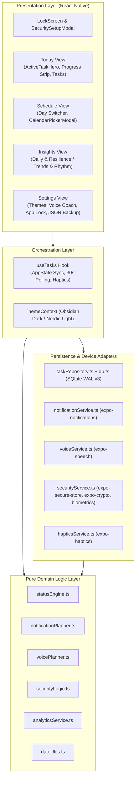

# Kairo — Technical Architecture Specification

**Package:** `com.kairo.app` • **Version:** `1.0.0`  
**Stack:** React Native `0.88` • Expo SDK `58` • TypeScript (strict) • Local SQLite (`expo-sqlite`)

---

## 1. System Overview

Kairo is a local-first, privacy-first daily execution and accountability application. Domain state transitions, analytics calculations, notification planning, voice alert planning, and security credential validation live in pure, deterministic TypeScript modules that are independent of React Native or Expo hardware APIs.

---

## 2. Database Schema & Migrations (`src/database/db.ts`)

Migrations execute sequentially inside `db.withTransactionAsync` via `PRAGMA user_version` with `journal_mode = WAL` and `foreign_keys = ON`:
- **Version 1:** Core `tasks`, `task_history`, and `task_reminders` tables plus schedule/status indexes.
- **Version 2:** `updated_at` column on `tasks`, `user_settings` key-value configuration table, and `idx_history_timestamp`.
- **Version 3:** `goals` table plus `goal_id`, `goal_day_number`, and `idx_tasks_goal_id` on `tasks` for recurring long-term milestones.

> Note: The SQLite filename remains `dayflow.db` to preserve full backward compatibility with existing on-device user databases.

---

## 3. Core Subsystems

### 3.1 Deterministic Task State Machine (`src/services/statusEngine.ts`)
- Transitions `upcoming` → `in_progress` → `missed` purely from timestamps (`now`, `startTime`, `endTime`).
- Completing an overdue task marks it `completed_late` without mutating original scheduled boundaries.
- `skipped` is explicitly distinct from `missed`.
- Idempotent reconciliation guarantees repeated ticks never emit duplicate `task_history` rows.

### 3.2 Hybrid Notifications & Voice Coach
- **Background / Lockscreen:** `notificationService.ts` schedules 3-tier OS alerts (`15min_before`, `at_start`, `overdue_checkin`) with rich metadata payloads (`taskId`, `triggerType`, `taskTitle`, `startTime`).
- **Active / Tap-to-Open Speech:** `App.tsx` checks `findDueVoiceAlerts()` on a 20s active ticker and listens to `Notifications.addNotificationResponseReceivedListener` to speak personalized alerts via `expo-speech`, buffered automatically until after unlock if App Lock is active.

### 3.3 Inbuilt App Lock & 5-Question Recovery
- Supports `pin4` (4 digits), `pin6` (6 digits), and `password` (8+ characters with letters & numbers).
- Credentials and all 5 normalized recovery answers are hashed with per-secret random salts via `expo-crypto` SHA-256 and persisted in hardware-backed storage (`expo-secure-store`, with SQLite fallback on web).
- Optional device biometrics (`expo-local-authentication`) and configurable background lock grace periods (`0s`, `60s`, `300s`).
